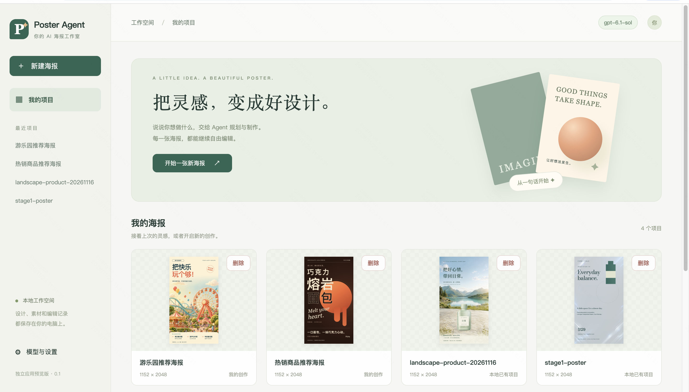

# Poster Agent

Poster Agent 是一个在本机运行的海报设计应用。描述设计需求并提供素材后，应用通过配置的模型规划和制作海报；生成的工程保留可编辑的文字、图片和布局，也可以在独立编辑器中继续调整。

项目基于 [Editable Design](https://github.com/yejy53/Editable-Design) 开发，包含本地网页应用和可供兼容智能体使用的 `poster-agent` Skill。目前是本地单用户预览版，使用源码启动，尚未提供正式安装包。



## 可以做什么

- 新建固定尺寸的海报工程，通过自然语言描述主题、内容和修改要求。
- 导入 PNG、JPEG、WebP 图片，以及 XLSX、CSV、JSON、TXT 和 Markdown 资料。单个文件不超过 5 MB。图片以原始文件保存；XLSX 读取工作表和原始单元格，公式只读取缓存结果。
- 调用支持工具调用的模型，结合素材生成或修改可编辑设计。任务执行记录、工程版本和导出结果保存在本机。
- 在独立编辑器中修改文字、替换图片、移动图层和调整尺寸；保存后可以继续通过对话修改当前版本。
- 将当前版本导出为 PNG，或下载包含工程文件、素材和记录的 ZIP。需要时可配置独立图像服务，生成背景或装饰素材。

## 运行要求

- Node.js 22.12 或更新版本，以及 npm。
- Bash 和常用命令行工具。macOS 和 Linux 可使用系统 Bash；Windows 需要 Git for Windows 提供的 Git Bash 等环境。
- Google Chrome 或 Chromium。应用使用 Chromium 内核浏览器进行图片导入、设计检查和 PNG 渲染，浏览器需单独安装。
- 可选：Python 3，用于读取 XLSX。读取程序仅使用 Python 标准库。
- 可选：命令行 `zip` 工具，用于下载 ZIP 工程。

使用设计助手还需要自行准备支持 Responses 或 Chat Completions 接口及工具调用的模型服务、模型名称和 API 密钥。图像生成需要支持相应 Images 接口的服务。预置模型名称不代表账户已获得权限；模型能力和服务商兼容性尚未经过真实服务验证。

## 安装与启动

### macOS 和 Linux

下载或克隆仓库后，在终端进入项目目录，执行：

```bash
cd /path/to/poster-agent
./dev.sh setup
./dev.sh app
```

将 `/path/to/poster-agent` 替换为实际目录。`setup` 使用 npm 安装运行依赖和字体包，并检查 Node.js、字体和浏览器；安装时需要访问 npm 软件源。需要再次检查环境时可运行 `./dev.sh doctor`。

应用会尝试打开默认浏览器，并在终端显示完整的本地访问地址。保持启动终端运行，按 `Ctrl+C` 停止。若浏览器没有自动打开，可复制终端中的完整地址访问；`./dev.sh app --no-open` 只显示地址。地址和会话信息由应用生成，无需手动指定端口。

macOS 安装依赖后，也可以双击项目根目录的 `启动 Poster Agent.command`。如果从压缩包解压后脚本失去执行权限，可在项目目录恢复权限：

```bash
chmod +x dev.sh scripts/*.sh skills/poster-agent/scripts/*.sh "启动 Poster Agent.command"
```

如果无法自动找到浏览器，可在启动前设置其可执行文件路径，例如：

```bash
export EDITABLE_DESIGN_BROWSER="/Applications/Google Chrome.app/Contents/MacOS/Google Chrome"
./dev.sh app
```

Linux 请填写实际的 Chromium 或 Chrome 可执行文件路径，例如 `/usr/bin/chromium`。

### Windows

安装 Node.js、Git for Windows 和 Chrome 后，打开 Git Bash，进入项目目录。以下示例假设 Git 和 Chrome 安装在默认位置，项目路径需要按实际情况修改：

```bash
cd "/c/Users/用户名/路径/poster-agent"
export PATH="/c/Program Files/Git/bin:/c/Program Files/Git/usr/bin:$PATH"
export EDITABLE_DESIGN_BROWSER="C:/Program Files/Google/Chrome/Application/chrome.exe"
./dev.sh setup
./dev.sh app
```

应用创建工程时会调用 `bash`，因此需要让 Git for Windows 的 `bin` 和 `usr/bin` 位于启动环境的 `PATH` 中。`EDITABLE_DESIGN_BROWSER` 应指向本机 Chrome 或 Chromium 的实际 `.exe` 文件；如果安装位置不同，请修改示例路径。本机已使用上述配置离线验证启动、新建工程及 PNG 渲染下载，其他 Windows 环境仍需自行检查。

如需读取 XLSX，请安装 Python 3。若命令名不是 `python3`，可在启动前设置 `export POSTER_AGENT_PYTHON="C:/实际路径/python.exe"`。下载 ZIP 工程还需让 `zip.exe` 位于 `PATH`；Git for Windows 不一定自带该工具，可以在 Git Bash 中用 `command -v zip` 检查。ZIP 导出和真实模型连接尚未在上述 Windows 验证中覆盖。

## 配置模型

首次启动会根据 `app/config.example.json` 创建 `app/config.local.json`。使用文本编辑器修改本地配置，将接口地址和模型名称替换为服务商提供的实际值。下面的示例通过环境变量读取密钥，图像服务默认关闭：

```json
{
  "model": {
    "apiFormat": "responses",
    "baseURL": "https://model-provider.example/v1",
    "model": "MODEL_ID",
    "apiKeyEnv": "POSTER_AGENT_MODEL_API_KEY",
    "supportsImages": false
  },
  "image": {
    "enabled": false,
    "useModelConnection": false,
    "baseURL": "https://image-provider.example/v1",
    "model": "gpt-image-1.5",
    "apiKeyEnv": "POSTER_AGENT_IMAGE_API_KEY"
  }
}
```

`model.apiFormat` 可填 `responses` 或 `chat-completions`，应与服务商支持的接口一致。`baseURL` 填 API 根地址，不要附加 `/responses`、`/chat/completions` 或其他具体请求路径；远程地址使用 HTTPS。`MODEL_ID` 需要替换为账户可用的完整模型名称。只有确认模型支持图片输入时，才将 `supportsImages` 设为 `true`；设为 `false` 时，模型无法查看图片预览，视觉检查需要人工完成。

上述示例中的 `image` 使用独立的地址和密钥。需要生图时，将 `enabled` 改为 `true`，确认图像模型在应用提供的列表中，并填写对应服务的 HTTPS 根地址。也可以在“模型与设置”中选择沿用主模型的连接。开启图像服务本身不会发送生图请求，每次生成都需要在界面中查看并批准具体计划。

使用环境变量时，在启动应用的 Bash 终端中输入密钥。下面的命令会隐藏输入内容：

```bash
read -r -s -p "主模型 API 密钥：" POSTER_AGENT_MODEL_API_KEY
printf '\n'
export POSTER_AGENT_MODEL_API_KEY
```

如果启用了独立图像服务，还需在同一终端设置图像密钥：

```bash
read -r -s -p "图像服务 API 密钥：" POSTER_AGENT_IMAGE_API_KEY
printf '\n'
export POSTER_AGENT_IMAGE_API_KEY
```

之后运行 `./dev.sh app`。环境变量由应用进程在启动时继承，修改变量后需要停止服务并重新启动。修改 JSON 文件后，可在“模型与设置”中点击“重新读取配置（不联网）”。

也可以使用 `apiKeyFile` 指定单独的密钥文件，或在本地 JSON 的 `apiKey` 字段填写密钥。macOS 和 Linux 上的密钥文件应仅供当前用户读取，例如使用 `chmod 600` 设置权限。`app/config.local.json` 已加入 `.gitignore`；仍应将密钥和包含密钥的配置保存在私人位置，不要上传或分享。可通过 `POSTER_AGENT_CONFIG` 指定其他配置文件路径。

设置页显示“就绪”表示本地配置已读取，并不表示服务商权限或接口兼容性已经验证。点击“发送并运行”后，应用会向配置的模型地址发送需求及任务所需资料，服务商可能收费。若使用其他地址或模型，请先确认其接口、工具调用和图片输入能力。

## 日常使用

1. 打开应用，点击“新建海报”，填写名称和画布尺寸。默认画布为 1152 × 2048 像素。
2. 在工程中上传商品图、参考图或文字与表格资料，并写明用途、价格、日期、规格等需要准确呈现的信息。
3. 输入设计需求，点击“发送并运行”。可在“执行记录”查看进度、工具调用和错误。以下是一条示例需求：

   > 使用上传的商品图制作竖版促销海报，保留商品原图和表格中的名称、规格与价格。整体使用清爽的浅色背景，价格要醒目；资料缺失时先指出。

4. 在画布预览中检查结果。需要手动调整时，打开“独立编辑器”，完成文字、图片或布局修改后保存，再回到主应用继续沟通。
5. 点击“重新导出”生成当前版本的 PNG，然后选择“下载 PNG”或“下载工程”。工程 ZIP 可能包含原始资料、需求和执行记录，分享前请检查内容。

如果任务提出图像生成计划，界面会显示地址、模型、提示词、尺寸等信息，批准后才发送请求。生图失败不会自动重试；服务是否收费及具体费用以服务商账单为准。

## 文件保存位置

应用默认将本地工作数据保存在仓库根目录的 `.poster-agent/`：

- `.poster-agent/projects/`：新建的海报工程、素材、设计版本和执行记录。
- `.poster-agent/deleted-projects/`：在界面确认删除后移入的工程。
- `.poster-agent/app-session.json`：本机服务的会话信息。

工程中的 `index.html` 是可编辑设计源文件；独立编辑器、导出图片及可能生成的图层拆解和 Replay 也随工程保留。配置文件 `app/config.local.json` 和 `.poster-agent/` 已加入 `.gitignore`。更换电脑时，应自行备份所需工程和配置，并在新环境重新安装依赖。

## 注册 Skill

本地网页应用不依赖 Skill 注册。若希望在支持 `~/.agents/skills` 的智能体环境中使用该 Skill，可在项目目录执行：

```bash
./dev.sh setup
./dev.sh register
```

注册脚本会将 `skills/poster-agent` 链接到 `~/.agents/skills/poster-agent`，不会覆盖已有的同名条目。移动源码目录后，需要重新处理该链接。Windows 上创建符号链接还取决于系统权限和 Git Bash 配置。注册完成后，在新的智能体会话中可使用 `$poster-agent`，具体工作流程见 [Skill 说明](skills/poster-agent/SKILL.md)。

## 项目结构

```text
poster-agent/
├── app/                         本地服务、模型连接和网页界面
├── docs/images/                 README 界面图片
├── scripts/register-skill.sh    Skill 注册脚本
├── skills/poster-agent/         Skill、编辑器、渲染工具和字体配置
├── dev.sh                       安装、启动和工具入口
├── 启动 Poster Agent.command    macOS 双击启动入口
├── LICENSE                      Apache-2.0 许可证
└── THIRD_PARTY_NOTICES.md       第三方归属说明
```

## 功能边界与许可

这是面向本机单用户的预览版，没有账号、多人协作、云端托管或正式桌面安装包。应用主要处理固定画布海报，当前不提供 PDF、PSD 或可编辑 PPTX 导出。大批量表格、自定义字体上传和自动恢复中断的付费请求也不在当前应用范围内。模型可能遗漏或误读内容，发布前请人工核对文案、数据、素材和画面。

项目源自 [Editable Design](https://github.com/yejy53/Editable-Design)，以 [Apache License 2.0](LICENSE) 发布。依赖、字体及其他第三方内容的许可和归属见 [第三方说明](THIRD_PARTY_NOTICES.md) 与 [Skill 第三方说明](skills/poster-agent/THIRD_PARTY_NOTICES.md)；上传或生成的素材仍受各自的权利和使用条件约束。
